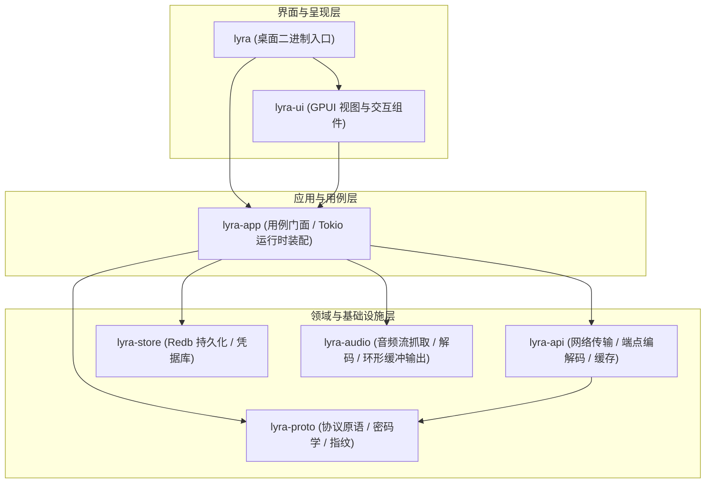

# Lyra · 酷狗概念版桌面客户端

<p align="center">
  <strong>基于 Rust 与 GPUI 构建的高性能、低开销酷狗概念版（Lite）桌面客户端</strong>
</p>

<p align="center">
  
  
  
  
  
</p>

---

## 📖 项目简介

Lyra 是一款采用纯 Rust 技术栈实现的酷狗音乐**概念版（Lite）**轻量桌面客户端。
协议层基于逆向契约与测试向量对拍实现，在内存占用、启动速度、运行稳定性和音质还原度上具备原生级体验。

> [!NOTE]
> 本项目仅供技术研究、学习与交流，严禁用于任何商业用途。项目不内置任何账号，不提供也不分发任何版权音频内容。

---

## ✨ 核心特性

- **字节级协议契约验证**：通过 17 项黄金测试向量（`vectors.rs`），确保签名算法、AES/RSA 加密、KRC 歌词解码及行为指纹与参考实现字节级一致。
- **纯 Rust 原生架构**：遵循极简依赖原则，网络传输基于 Rustls 与系统根证书，零 C/C++ 动态链接隐患。
- **低延迟流式音频引擎**：采用抓取、解码、重采样与输出环形缓冲四层解耦设计，支持边下边播与无缝瞬时切歌。
- **双层智能缓存体系**：
  - **L1 内存缓存**：基于 TinyLFU 驱逐策略管理高频接口请求，并针对并发相同请求提供 Single-Flight 聚合。
  - **L2 磁盘持久化**：基于 Redb 嵌入式键值存储与文件系统 Blob 缓存，具备容量上限控制与 LRU 淘汰机制。
- **系统级凭据安全**：账号敏感令牌（Token）统一交由 Windows 凭据管理器（Credential Manager）加密持久化，不落明文数据库，避免日志泄露。
- **现代响应式 UI**：基于 GPUI 渲染引擎构建，界面流畅无卡顿，内置滚动歌词联动、电台频道发现与个性化音质选择。

---

## 🏗️ 架构分层

整个工作区采用高内聚、单向依赖的分层设计，核心逻辑与图形界面完全解耦：



### 工作区模块矩阵

| Crate | 核心职责 | 关键依赖 | 依赖 GPUI |
|---|---|---|:---:|
| [`lyra-proto`](file:///d:/YZB/Kugou/crates/proto) | 协议原语：签名计算、AES/RSA 密码学、设备身份生成、仿真行为指纹 | `ring`, `aes`, `rsa`, `flate2` | 否 |
| [`lyra-api`](file:///d:/YZB/Kugou/crates/api) | 接口传输抽象、端点请求编解码、TinyLFU 缓存与 Single-Flight 请求聚合 | `reqwest`, `moka`, `serde_json` | 否 |
| [`lyra-store`](file:///d:/YZB/Kugou/crates/store) | 本地数据持久化（设备标识、配置、缓存）与系统凭据管理 | `redb`, `windows` (CredEnumerate) | 否 |
| [`lyra-audio`](file:///d:/YZB/Kugou/crates/audio) | 音频流处理：Symphonia 解码、音频重采样、环形缓冲与非阻塞事件引擎 | `cpal`, `symphonia`, `rubato` | 否 |
| [`lyra-app`](file:///d:/YZB/Kugou/crates/app) | 业务用例门面（`Kugou`）组装、Tokio 异步运行时管控与 CLI 命令入口 | `tokio`, `tracing` | 否 |
| [`lyra-ui`](file:///d:/YZB/Kugou/crates/ui) | GPUI 现代化桌面交互视图（歌单、搜索、电台、歌词、播放条、设置） | `gpui-kit` | 是 |
| [`lyra`](file:///d:/YZB/Kugou/crates/desktop) | 桌面端可执行程序入口，支持无参数启动 GUI 或带参数运行 CLI | `lyra-app`, `lyra-ui` | 是 |
| [`xtask`](file:///d:/YZB/Kugou/crates/xtask) | 开发与 CI 辅助任务：依赖树静态合规审计与真实上游端点连通性探测 | `anyhow`, `cargo_metadata` | 否 |

---

## 🚀 快速上手

### 环境依赖

- **操作系统**：Windows 10 / 11 (x86_64)
- **Rust 工具链**：Rust 1.85+（Edition 2024）
- **C/C++ 编译环境**：MSVC 工具链（构建底层音频库所需）

### 构建与运行

#### 1. 启动图形桌面客户端

```powershell
cargo run --release -p lyra
```

#### 2. 运行命令行交互工具（CLI）

客户端支持通过子命令快速测试协议流程：

```powershell
# 查看所有支持的命令
cargo run -p lyra -- help

# 查看当前登录状态与设备指纹
cargo run -p lyra -- whoami

# 发送登录短信验证码
cargo run -p lyra -- code 13800000000

# 短信验证码登录
cargo run -p lyra -- login 13800000000 123456

# 查看用户歌单
cargo run -p lyra -- playlists

# 查看指定歌单中的曲目列表
cargo run -p lyra -- tracks <global_collection_id>

# 查询指定曲目的音质权益矩阵
cargo run -p lyra -- rights <song_hash>

# 获取播放直链（专辑 id 可省略，音质是第三个参数）
cargo run -p lyra -- url <song_hash> [album_id] [quality]

# 下载音频并校验文件头魔数（FLAC / OggS）
cargo run -p lyra -- download <song_hash> [album_id] <output_file>
```

---

## 🧪 测试与质量保证

项目具备完备的离线单元测试、契约测试和静态依赖扫描机制：

### 运行全工作区离线测试

```powershell
# 运行全部 197 个测试（完全离线，基于 Mock 桩与确定性伪随机源）
cargo test --workspace
```

### 代码格式与 Lint 校验

```powershell
# 代码格式检查
cargo fmt --all --check

# Clippy 严格静态检查
cargo clippy --workspace --all-targets -- -D warnings
```

### 自动化构建任务

```powershell
# 依赖树审计：列出非 Rust 工件与系统绑定，并拦截被禁用的 C 实现 TLS 后端
cargo xtask audit

# 真实上游存活性冒烟测试（仅限开发/联调，不进入 CI 流程）
cargo xtask smoke

# 本地打包：编译 Release 二进制并打包 Windows 安装程序
cargo run -p xtask -- package
```

---

## 📦 安装程序与发布分发 (Release)

项目在 GitHub Releases 中直接分发两种格式的 Windows 产物：

| 分发形态 | 产物文件名示例 | 适用场景与特性 |
| :--- | :--- | :--- |
| **向导安装程序 (Setup)** | `Lyra-v0.1.0-windows-x64-setup.exe` | **推荐**。双击启动现代安装向导，支持选择安装路径，自动创建桌面及“开始”菜单快捷方式，并在 Windows 设置 / 控制面板注册标准卸载向导。 |
| **绿色免安装版 (Portable)** | `Lyra-v0.1.0-windows-x64-portable.zip` | 解压即用。内含单一无依赖原生二进制 `lyra.exe`，不写注册表，适合便携式 U 盘或快速体验。 |

### 自动化发布流程 (CI/CD)

项目已配置标准 GitHub Actions 发布工作流 [`.github/workflows/release.yml`](.github/workflows/release.yml)：
1. **触发方式**：推送版本标签（例如 `git tag v0.1.0 && git push origin v0.1.0`）或在 GitHub Actions 页面点击“Run workflow”手动触发；
2. **自动化编译**：在 `windows-latest` 环境中执行 `cargo build --release -p lyra`，由 fat LTO 与单代码生成单元深度优化；
3. **安装向导打包**：调用 [Inno Setup 脚本](installer/lyra.iss) 自动生成标准 Windows 安装向导 `.exe`；
4. **校验与归档**：自动打包绿色免安装 `.zip`，生成 SHA256 校验清单，并将所有产物挂载至 GitHub Release 供用户直接下载。

---

## 🔒 安全与隐私设计

1. **凭据安全**：用户登录凭据（`token` 与 `vip_token`）通过系统原生安全接口落盘在 Windows 凭据管理器中，主数据库 `lyra.redb` 仅持久化不含敏感信息的账号属性。
2. **设备指纹固定**：首次启动生成稳定唯一的设备标识（`mid`, `guid`, `webgl`），避免因动态随机变化触发上游风控限流机制。
3. **敏感信息脱敏**：CLI 输出及日志记录中全面对令牌、手机号与敏感凭据进行掩码处理，严格防止信息外泄。

---

## 📄 开源许可证

本项目采用 [MIT 许可证](LICENSE) 或 [Apache-2.0 许可证](LICENSE-APACHE) 授权。
