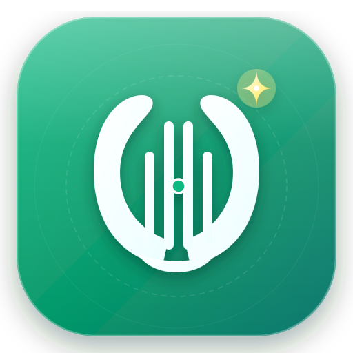
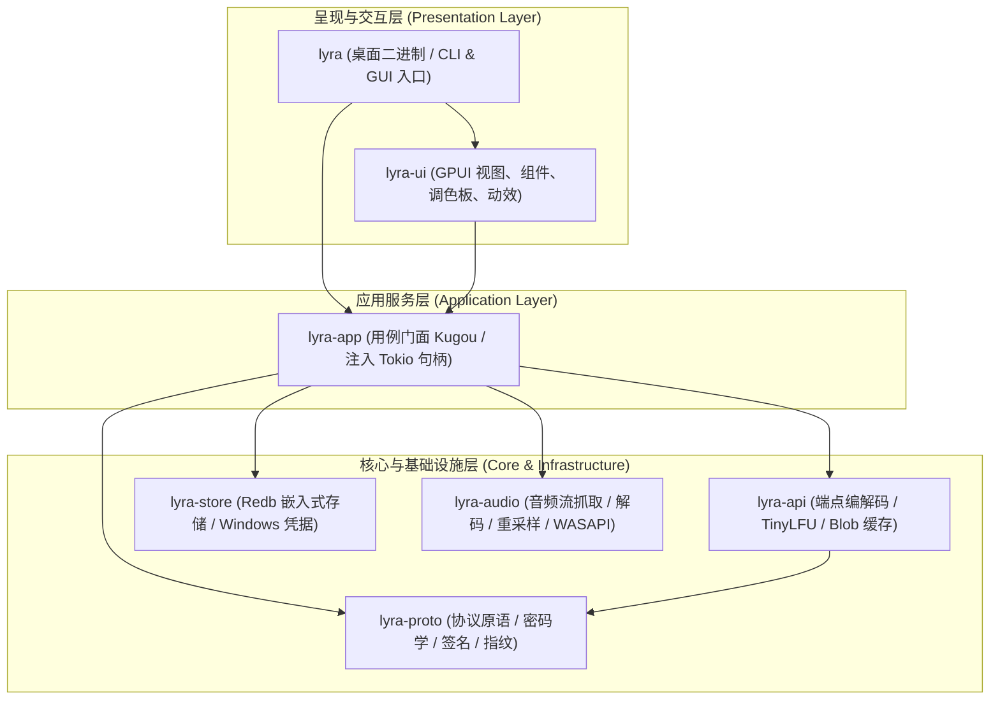

# Lyra (天琴) · 现代化原生桌面音乐客户端

<p align="center">
  
</p>

<p align="center">
  <strong>基于 Rust 2024 与 GPUI 构建的高性能、低开销、全端点覆盖的原生桌面音乐客户端</strong>
</p>

<p align="center">
  
  
  
  
  
  
</p>

---

## 📖 项目简介

**Lyra (天琴)** 是一款完全采用纯 **Rust** 技术栈与 **GPUI** 渲染引擎自研打造的桌面音乐播放客户端。针对现代桌面系统深度优化，摆脱了传统基于 Electron 等 Web 技术框架所带来的高内存占用、高 CPU 消耗及迟滞卡顿等通病。

通过自研的端点契约引擎、无锁环形缓冲音频管线与 GPU 硬件加速渲染，Lyra 在 Windows 桌面端实现了毫秒级冷启动、极致顺滑的 120 FPS 渲染体验以及细腻的原生桌面端交互。

> [!NOTE]
> 本项目仅供软件工程、Rust 系统编程与图形界面交互设计的技术研究与交流使用，严禁用于任何商业用途。
> 客户端不内置任何账号，不提供、不上传、也不分发任何受版权保护的音频媒体文件。

---

## ✨ 核心特性

### 1. 极致轻量与高帧率原生渲染 (GPUI Accelerated)
- **毫秒级极速冷启动**：整机冷启动时间通常 < 200ms，内存常驻仅在 50~80MB 左右（相比 Web 套壳客户端的 500MB~1GB 节省 85% 以上内存消耗）。
- **GPU 硬件直驱渲染**：依托 GPUI 底层 Win32 / Direct3D 平台绑定，交互操作帧率稳定在 60~120 FPS，列表滚动与动画过渡丝滑流畅。
- **全源码内存安全**：全工作区模块顶层强制启用 `#![forbid(unsafe_code)]`，杜绝内存越界、悬垂指针与数据竞争风险。

### 2. 沉浸式动态弥散歌词 (Ambient Mesh Blur)
- **智能封面色彩量化提取**：引入 MMCQ / HSL 动态色彩提取算法，从专辑封面图片自适应提取主导饱和色调并映射到底层超大半径弥散光晕，告别灰暗脏斑与生硬阴影。
- **景深距离衰减排版**：歌词排版建立垂直景深距离衰减光学模型，当前焦点句 26px 加粗聚焦，前后邻近句子平滑透明度衰减，上下两端融入淡入淡出透明遮罩。
- **打点推进与流体滚动**：支持精细时间戳平滑阻尼滚动，提供沉浸感极佳的视觉享受。

### 3. 桌面端专业曲目表格 (Table Grid System)
- **高密度信息架构**：彻底重构移动端单列堆叠布局，采用专业桌面端单行多列网格：
  - `#` 序号居中，播放时无缝切为 3 柱跳动音频声波均衡器；
  - `标题` 弹性拉伸，支持封面微缩预览、曲名与 SQ / Hi-Res 无损标签；
  - `歌手` / `专辑` 独立列排布，支持悬浮高亮；
  - `时长与操作` 居右对齐，鼠标 Hover 智能淡出时长并平滑浮现「红心收藏」与「更多操作」菜单，隐藏危险操作避免误触。

### 4. 全局收敛搜索入口
- **根除双搜索框冲突**：主内容区彻底去除重复的大搜索输入框与黑底按钮，收敛为顶部全局常驻搜索框。
- **无干扰输入**：搜索框获得焦点不再弹出任何下拉浮层，回车即执行全网检索。
- **4 维分类与多维排序**：搜索结果支持单曲、专辑、歌手、歌单 Tab 切换，以及综合、最新、最热排序筛选。
- **滚动续取**：歌单与搜索结果均按游标自动分页，滚到接近末尾即续取下一页，不再被单页条数截断。

### 5. 专业级歌单视觉重塑
- **仪式感 Header**：大尺寸 160×160px 圆角封面，「我喜欢」歌单定制双色渐变红心封面与环境光漫反射投影。
- **完整元数据与操作工具条**：真实绑定曲目总数，集成品牌绿色胶囊「▷ 播放全部」、「批量操作」与「更多选项」。

### 6. 专业流式音频处理管线 (Decoupled Audio Pipeline)
- **四层解耦音频引擎**：音频流抓取（`BlobFetcher`）、全格式解码（`symphonia` 支持 FLAC / MP3 / Vorbis / AAC / WAV）、异步高品质重采样（`rubato`）与 WASAPI 环形缓冲输出（`cpal`）四层完全解耦，切歌即时响应无爆音。
- **音量无损记忆恢复与持久化**：
  - 彻底解决静音后恢复音量变成默认 80% 的硬编码缺陷；
  - 维护非零音量记忆（`last_unmuted_volume`），点击静音置零，再次点击精准恢复原音量（如 35%）；
  - 静音状态下滚动滚轮或拖动滑块智能解除静音并平滑微调；
  - 重启客户端自动恢复持久化音量配置与静音状态。

### 7. 多级缓存体系与安全隐私防护
- **L1 内存缓存**：基于 TinyLFU 驱逐策略管理高频接口请求，并针对并发相同请求提供 Single-Flight 聚合防击穿。
- **L2 磁盘持久化**：基于 Redb 嵌入式键值数据库保存设备指纹与应用配置；音频流分片按配额限制 LRU 自动回收。
- **系统级凭据安全隔离**：用户登录凭据（`token` 与 `vip_token`）交由 Windows 凭据管理器（Credential Manager）加密持久化，本地数据库与运行日志零明文。

---

## 🏗️ 架构分层设计

工作区采用单向依赖的高内聚分层设计，领域与基础设施逻辑完全不依赖图形渲染引擎，可 100% 进行无头自动化测试：



### 工作区 Crate 矩阵清单

| Crate | 核心职责 | 核心依赖库 | 是否依赖 GPUI | 内存安全级别 |
|:---|:---|:---|:---:|:---:|
| [`lyra-proto`](crates/proto) | 协议原语：请求签名、AES/RSA 加密、设备仿真指纹、KRC 歌词解密 | `ring`, `aes`, `rsa`, `flate2`, `base64` | 否 | `forbid(unsafe)` |
| [`lyra-api`](crates/api) | 上游网络通信抽象、端点请求编解码、TinyLFU 内存缓存、磁盘分片缓存 | `reqwest`, `moka`, `serde_json`, `tokio` | 否 | `forbid(unsafe)` |
| [`lyra-store`](crates/store) | 本地配置持久化、设备标识管理、Windows 原生凭据管理器加密存取 | `redb`, `windows` (CredEnumerate), `serde` | 否 | `forbid(unsafe)` |
| [`lyra-audio`](crates/audio) | 音频流解码与输出：Symphonia 解码、Rubato 重采样、CPAL 环形缓冲输出 | `cpal`, `symphonia`, `rubato`, `ringbuf` | 否 | `forbid(unsafe)` |
| [`lyra-app`](crates/app) | 业务用例门面（`Kugou`）编排、CLI 路由；运行时句柄统一外部注入 | `tokio`, `tracing`, `tempfile` | 否 | `forbid(unsafe)` |
| [`lyra-ui`](crates/ui) | GPUI 现代化桌面交互视图（歌单、搜索、发现、歌词、播放条、设置） | `gpui-kit`, `image` | **是** | `forbid(unsafe)` |
| [`lyra`](crates/desktop) | 桌面端可执行程序入口，支持无参数启动 GUI 或带子命令运行 CLI | `lyra-app`, `lyra-ui`, `tokio` | **是** | `forbid(unsafe)` |
| [`xtask`](crates/xtask) | 项目工程化任务工具箱：纯 Rust 依赖审计、上游探测与发布打包 | `anyhow`, `sha2`, `zip` | 否 | `forbid(unsafe)` |

---

## 🚀 快速上手

### 环境需求

- **操作系统**：Windows 10 / 11 (x86_64)
- **Rust 工具链**：Rust 1.99+ (Edition 2024，见根目录 `Cargo.toml`)
- **构建工具**：Visual Studio MSVC C++ 构建工具（构建底层音频库所需）
- **打包工具（可选）**：[Inno Setup 6](https://jrsoftware.org/isdl.php)（用于本地执行 `cargo xtask package` 生成安装向导）

---

### 构建与运行

#### 1. 启动图形桌面客户端 (GUI)

```powershell
# 运行调试版
cargo run -p lyra

# 运行极致优化的 Release 优化版（推荐）
cargo run --release -p lyra
```

#### 2. 使用命令行工具交互 (CLI)

客户端二进制支持无缝接收子命令进行快速接口测试与协议验证：

```powershell
# 查看所有支持的子命令
cargo run -p lyra -- help

# 查看当前登录身份与本地生成的仿真设备标识
cargo run -p lyra -- whoami

# 向指定手机号发送短信验证码
cargo run -p lyra -- code 13800000000

# 短信验证码登录
cargo run -p lyra -- login 13800000000 123456

# 查看当前用户的自建与收藏歌单
cargo run -p lyra -- playlists

# 查看指定歌单中的曲目列表
cargo run -p lyra -- tracks <global_collection_id>

# 查询指定曲目的音质权益与播放权限矩阵
cargo run -p lyra -- rights <song_hash>

# 获取音频直链播放地址（专辑 ID 可选，第三参数指定音质如 128 / 320 / flac）
cargo run -p lyra -- url <song_hash> [album_id] [quality]

# 下载音频文件并校验文件头格式魔数 (FLAC / ID3 / OggS)
cargo run -p lyra -- download <song_hash> [album_id] <output_file_path>
```

---

## 🧪 测试与质量保障

项目实施了极其严格的离线测试验证、契约对拍与依赖供应链审计机制：

```powershell
# 1. 运行全工作区离线自动化测试套件（覆盖全部 300 个用例，完全离线运行）
cargo test --workspace

# 2. 检查代码格式规范
cargo fmt --all --check

# 3. 运行严格静态分析与 Lint 检查
cargo clippy --workspace --all-targets -- -D warnings

# 4. 运行依赖供应链安全审计（扫描依赖树，拦截任何未确认的 C 实现与动态链接）
cargo xtask audit

# 5. 一键生成 Release 安装程序与免安装便携包
cargo xtask package
```

---

## 📦 发布分发形态 (Releases)

项目通过 `cargo xtask package` 或 GitHub Actions 自动化编译打包并生成两种形态的标准 Windows 产物：

| 分发形态 | 产物文件名示例 | 特性说明与适用场景 |
| :--- | :--- | :--- |
| **标准安装程序 (Setup)** | `Lyra-v0.2.0-windows-x64-setup.exe` | **推荐日常使用**。基于 Inno Setup 引擎构建，提供标准安装向导，自动创建桌面与开始菜单快捷方式，支持自定义安装目录，并在 Windows 系统的应用与功能中注册完整的卸载向导。 |
| **绿色免安装包 (Portable)** | `Lyra-v0.2.0-windows-x64-portable.zip` | 解压即用。包含独立原生二进制可执行文件 `lyra.exe`，不写入系统注册表，所有数据默认保存在用户目录，非常适合存入移动存储设备随身携带。 |

打包完成后，脚本会自动计算各产物的 SHA256 散列并输出至 `target/dist/checksums.sha256`。

---

## 🔒 隐私与凭据安全设计

1. **凭据安全隔离**：用户登录凭据（`token` 与 `vip_token`）通过系统原生安全接口存储于 Windows 凭据管理器（Credential Manager）中，主数据库 `lyra.redb` 仅持久化不含敏感属性的账户信息。
2. **设备指纹持久化**：首次启动生成稳定且唯一合规的设备标识（`mid`, `guid`, `webgl`），避免因动态随机变化触发上游风控限流机制。
3. **敏感信息动态掩码**：CLI 输出及日志记录中全面对手机号、设备秘钥及用户凭据进行动态脱敏掩码，杜绝泄露风险。

---

## 📄 开源许可证

本项目基于 [MIT 许可证](LICENSE) 开源。
